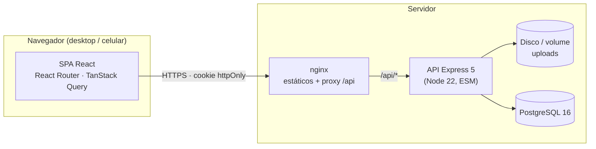
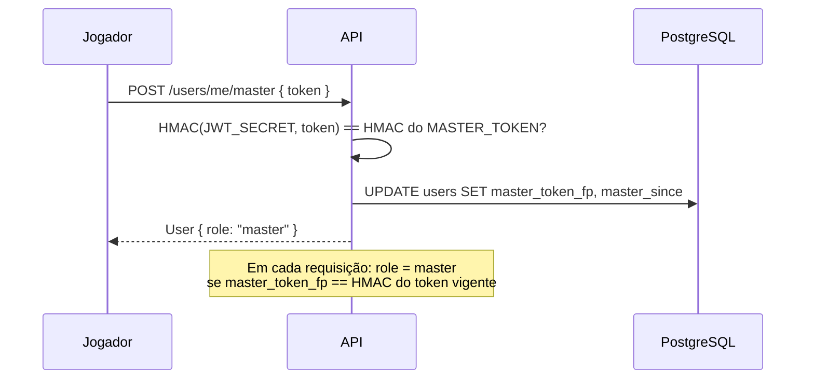
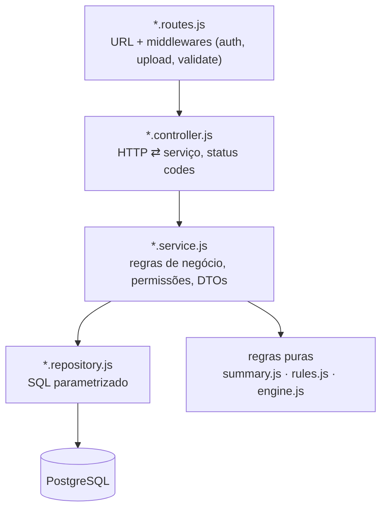
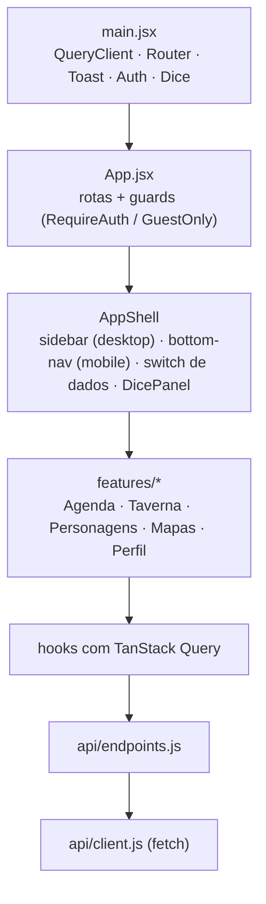

# Arquitetura

## Visão geral



### Modo mestre (token)



- O papel não é fixo: qualquer jogador vira mestre com o token e volta a ser jogador com `DELETE /users/me/master`.
- Pode haver mais de um mestre ao mesmo tempo (jogos diferentes, co-mestres).
- O token nunca é salvo — apenas sua impressão digital (HMAC-SHA256). Trocar `MASTER_TOKEN` no servidor revoga todos os mestres na próxima requisição.

### Rolagens visíveis para todos

O `RollFeed` (no `AppShell`, presente em todas as abas) consulta `GET /dice/rolls?after=<última rolagem vista>` a cada 4 s
(pausa quando a aba do navegador está em segundo plano). Rolagens de outros jogadores aparecem como aviso no canto da tela
e entram no histórico do painel. Isso vale **mesmo com o switch de dados desligado**: o switch controla apenas a ferramenta de rolar.

---

Frontend e API são servidos **na mesma origem** (nginx em produção, proxy do Vite em desenvolvimento).
Isso permite autenticação por **cookie httpOnly** e que ``/visualizador de PDF carreguem arquivos
protegidos sem expor tokens em URLs.

## Backend — arquitetura em camadas por módulo

Cada domínio (`auth`, `users`, `availability`, `sessions`, `characters`, `media`, `tavern`, `dice`) tem os mesmos arquivos:



| Camada | Responsabilidade | Não pode |
| ------ | ---------------- | -------- |
| **Routes** | Declara endpoints e a ordem dos middlewares | Ter lógica |
| **Controller** | Lê `req.valid`, chama o serviço, escolhe o status HTTP | Acessar banco |
| **Service** | Regras de negócio, autorização (dono/mestre), mapeamento para DTO (camelCase) | Conhecer `req`/`res` |
| **Repository** | Somente SQL parametrizado (`$1, $2…`) | Ter regra de negócio |
| **Regras puras** | Comparação de agendas, máquina de estados da Taverna, motor de dados | Fazer I/O |

As regras puras são o coração testável do sistema: `npm test` roda sem banco e sem dependências externas.

### Pipeline de uma requisição

```
helmet → cors → json(100kb) → cookieParser → pino-http
  → requireAuth (JWT do cookie + recarrega usuário do banco)
  → uploadFields (multer → verificação de magic bytes)
  → validate (Zod → req.valid)
  → controller → service → repository
  → errorHandler (AppError | Multer | erros do Postgres → JSON padronizado; apaga uploads órfãos)
```

### Tratamento de erros

Todas as respostas de erro têm o mesmo formato:

```json
{ "error": { "code": "VALIDATION_ERROR", "message": "Dados inválidos", "details": { "fieldErrors": { "email": ["E-mail inválido"] } } } }
```

- `AppError` (400/401/403/404/409/415/422) → mensagem segura para o usuário.
- Violações do Postgres viram respostas HTTP: `23505` → 409, `23503` → 400, `23514` → 422.
- Qualquer outro erro → 500 genérico, com stack apenas no log.
- Se a requisição falhar **depois** de um upload, os arquivos recém-gravados são apagados (sem lixo no disco).

### Segurança

| Ameaça | Mitigação |
| ------ | --------- |
| Roubo de sessão via XSS | JWT em cookie **httpOnly**, `SameSite=Lax`, `Secure` em produção |
| CSRF | `SameSite=Lax` + API só aceita JSON/multipart nas mutações + CORS restrito com `credentials` |
| Força bruta no login | `express-rate-limit` (20 tentativas / 15 min) em `/auth/login` e `/auth/register` |
| Enumeração de e-mails | Login sempre executa `bcrypt.compare` (hash fictício quando o e-mail não existe) |
| Senhas | bcrypt com custo 12; nunca retornadas pela API; redigidas dos logs |
| SQL injection | 100% queries parametrizadas; nomes de colunas em updates vêm de whitelist |
| Upload malicioso | Lista de MIME permitidos **e** verificação de magic bytes; nome do arquivo = UUID gerado no servidor; extensão coerente com o conteúdo; limite de tamanho |
| Path traversal | `path.basename` no acesso a arquivos; `express.static` com `dotfiles: deny` |
| Acesso a arquivos | `/api/files/*` exige login |
| Autorização | `requireRole('master')` nas rotas de escrita de Mapas/NPCs (antes do upload); nos demais recursos, `canManage(user, ownerId)` = dono **ou** mestre |
| Grupo fechado | `INVITE_CODE` opcional, comparado em tempo constante |
| Token de mestre | Só o HMAC do `MASTER_TOKEN` é guardado; comparação em tempo constante; limite de 10 tentativas / 15 min; trocar o token revoga todos os mestres |
| Cabeçalhos | `helmet` na API; CSP, `nosniff` e `Referrer-Policy` no nginx |
| Dados de entrada | Zod `.strict()` em todos os bodies (campos desconhecidos são rejeitados) |

### Concorrência

- **Taverna**: transições usam *controle otimista* — `UPDATE … WHERE id = $1 AND status = $esperado`. Se outra pessoa assumiu o item antes, a API responde **409** e o front recarrega a lista.
- **Agenda**: gravação em lote dentro de transação; `ON CONFLICT (user_id, date) DO UPDATE` torna a operação idempotente.

### Arquivos

`storage/fileStorage.js` é a única porta de acesso ao disco. O banco guarda só o **nome** do arquivo; a URL é montada no mapper (`/api/files/<uuid>.<ext>`). Para migrar para S3/R2/MinIO basta reimplementar esse módulo.
Arquivos substituídos ou de registros excluídos são removidos **depois** que o banco confirma a operação.

## Frontend



**Princípios aplicados**

- **Organização por feature** (`features/agenda`, `features/tavern`…): tudo de uma tela fica junto.
- **Estado de servidor ≠ estado de UI**: dados da API vivem no cache do TanStack Query (com chaves centralizadas em `qk`); estado local fica em `useState`; estado global mínimo em Context (usuário, switch de dados, toasts).
- **Atualização otimista** na agenda e no switch de dados: a interface responde na hora e desfaz se a API falhar.
- **Code splitting**: cada rota é `lazy()`; o rolador de dados e o pdf.js só são baixados quando usados.
- **Um único cliente HTTP** (`api/client.js`): cookies, JSON/FormData e conversão de erros em `ApiError`.
- **Acessibilidade**: navegação por teclado, `role="switch"`/`aria-checked`, `aria-live` nos resultados de dados e toasts, link "pular para o conteúdo", respeito a `prefers-reduced-motion`.
- **Responsivo mobile-first**: abaixo de 900 px a barra lateral vira navegação inferior (como no layout de referência), o painel de dados ocupa a largura da tela e respeita `safe-area-inset` do iPhone.

### Tema visual

Baseado nas imagens de referência: fundo escuro com brilho roxo, molduras douradas, títulos em **Cinzel** e corpo em **Inter**.
Todos os valores ficam em variáveis CSS (`--gold`, `--purple`, `--surface`…) no topo de `styles/global.css`.

Melhorias em relação ao mock-up:

- Calendário com dois modos (marcar × comparar) e “pincel” de status, em vez de só exibir pontos.
- Ranking automático de **melhores datas** com atalho para marcar a sessão.
- Marcadores interativos no mapa (como na referência), salvos no banco.
- Histórico de rolagens **compartilhado**, avisos ao vivo para todos e rolagem no servidor (o resultado é confiável para todos).
- Visualizador de PDF próprio (pdf.js), porque `<iframe>` de PDF não funciona bem no iOS/Android.
