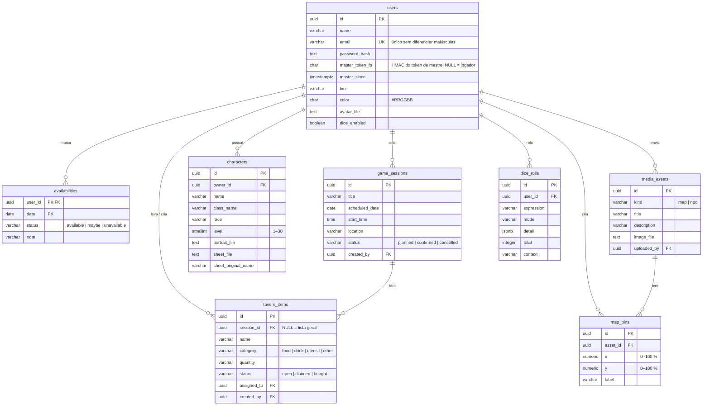

# Banco de dados

**TiDB Cloud** (compatível com MySQL 8; também roda em MySQL 8.0+). Esquema em [`backend/src/db/migrations/`](../backend/src/db/migrations/): `001_initial_schema.sql` e `002_email_verification.sql` (coluna `users.email_verified_at` + tabela `email_verifications`, com o HMAC do código, validade, tentativas e último envio).

IDs são UUIDs gerados pela aplicação (`crypto.randomUUID()`) em `CHAR(36)`. Datas/horas são `DATETIME(3)` em UTC (a conexão fixa `time_zone = '+00:00'`); colunas `DATE` trafegam como texto `YYYY-MM-DD`.

## Modelo entidade-relacionamento

Todas as tabelas têm `created_at`; as editáveis também têm `updated_at`, mantido pelo próprio banco (`ON UPDATE CURRENT_TIMESTAMP(3)`; o TiDB não tem triggers).

## Integridade garantida pelo banco

| Regra | Como |
| ----- | ---- |
| E-mail único sem diferenciar maiúsculas | a API grava o e-mail em minúsculas + `UNIQUE KEY users_email_unique (email)` |
| Uma marcação por pessoa por dia | `PRIMARY KEY (user_id, date)` em `availabilities` |
| Valores de enum válidos | `CHECK (status IN (…))` em todas as colunas de status/tipo |
| Cor válida | `CHECK (color REGEXP '^#[0-9A-Fa-f]{6}$')` |
| Modo mestre coerente | `CHECK ((master_token_fp IS NULL) = (master_since IS NULL))` |
| Item da Taverna coerente | máquina de estados em `tavern.rules.js` + UPDATE condicional (concorrência otimista) |
| Marcador dentro da imagem | `CHECK (x BETWEEN 0 AND 100 AND y BETWEEN 0 AND 100)` |

> No TiDB, os `CHECK` só são aplicados com `SET GLOBAL tidb_enable_check_constraint = ON`. Sem isso eles ficam
> só como documentação — as mesmas regras já são validadas na API (Zod + regras de domínio).

## Exclusões em cascata

| Ao excluir… | Acontece |
| ----------- | -------- |
| um usuário | apaga disponibilidade, personagens e rolagens; sessões/mídias/itens ficam com autor `NULL` |
| uma sessão | apaga os itens da Taverna dela |
| um mapa | apaga seus marcadores |
| alguém responsável por item | `assigned_to` vira `NULL`. Sem triggers no TiDB, ao excluir uma conta manualmente rode antes `UPDATE tavern_items SET status = 'open', assigned_to = NULL WHERE assigned_to = '<id>'` |

## Índices

| Índice | Consulta atendida |
| ------ | ----------------- |
| `availabilities_date_idx (date)` | resumo do mês (`WHERE date BETWEEN …`) |
| `game_sessions_date_idx (scheduled_date)` | calendário e próximas sessões |
| `characters_owner_idx (owner_id)` | personagens por jogador |
| `media_assets_kind_idx (kind, created_at DESC)` | galeria por aba |
| `map_pins_asset_idx (asset_id)` | marcadores de um mapa |
| `tavern_items_session_idx (session_id)` | lista da Taverna por sessão |
| `tavern_items_assigned_idx (assigned_to)` | liberar itens ao excluir usuário |
| `dice_rolls_created_idx (created_at DESC)` | histórico recente |

## Migrações

- Arquivos `NNN_descricao.sql` em `backend/src/db/migrations/`, aplicados em ordem alfabética.
- Cada um é registrado em `schema_migrations` — rodar de novo não faz nada. No TiDB/MySQL, DDL faz commit implícito: se uma migração falhar no meio, desfaça manualmente o que já foi criado.
- A API aplica migrações pendentes ao iniciar; também é possível rodar `npm run migrate`.
- **Nunca edite uma migração já aplicada**: crie `002_…sql`.

## Backup

- **TiDB Cloud:** o plano Starter faz backups automáticos (veja *Backup* no painel do cluster). Para uma cópia própria:
  `mysqldump -h HOST -P 4000 -u USUARIO -p --ssl-mode=VERIFY_IDENTITY gremad > backup.sql`
- **Arquivos:** ficam no bucket do Cloudflare R2 (ou no volume `uploads`, sem R2).
